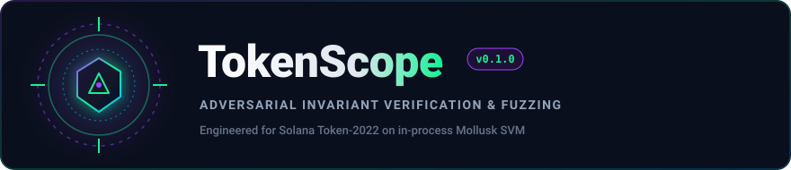

<p align="center">
  
</p>

<p align="center">
  <a href="https://github.com/integral-830/tokenscope/actions/workflows/ci.yml"></a>
  <a href="https://github.com/integral-830/tokenscope/actions/workflows/tokenscope-audit.yml"></a>
  <a href="LICENSE"></a>
  <a href="docs/toolchain.md"></a>
  <a href="docs/supported-extensions.md"></a>
  <a href="https://github.com/integral-830/tokenscope"></a>
  <a href="docs/experiments/svm-framework.md"></a>
  <a href="FORMAT.md"></a>
</p>

# TokenScope

TokenScope is a Rust framework for **adversarial testing of Solana Token-2022 integrations**. It
executes real programs in a real Solana Virtual Machine (the Mollusk SVM with the real Token-2022
program), checks explicit invariants against *decoded on-chain account state*, minimizes failures,
and writes reproducible findings.

```
Target adapter -> Scenarios -> Real SVM execution -> Invariant checking -> Shrinking -> Findings
```

> **Status:** version 0.1.0. One target (a demo escrow), six invariants, and 252 passing workspace
> tests. Token-2022 behavior verified by executable tests: transfer fees (including epoch delays,
> `TransferCheckedWithFee`, harvest and withdraw), freeze/thaw, DefaultAccountState, Pausable,
> transfer hooks (fixture hook), CPI Guard (direct and CPI forwarder fixture), delegates, permanent
> delegate, multisig authorities (threshold signing and on-chain quirks), required transfer memos
> with atomic rollback, pointer extensions (MetadataPointer, GroupPointer, GroupMemberPointer), and
> extension compatibility. See [Limitations](#limitations) and
> [docs/supported-extensions.md](docs/supported-extensions.md) before relying on any result.
> TokenScope does not detect vulnerabilities in general, and an invariant violation is **not**
> proof of exploitability. It is also not the first tool in this space; see
> [docs/research.md](docs/research.md) for an evidence-based comparison with Trident and Crucible.

## The demonstration

Token-2022 transfer fees mean the amount a program *sends* is not the amount that *arrives*. The
demo escrow ships in two flavors built from one source (`programs/demo-escrow`):

* **vulnerable** credits the nominal deposit amount;
* **corrected** (`--features corrected`) credits the vault's real balance change.

With a 2% fee, depositing 1,000 credits 1,000 on the vulnerable escrow while the vault holds 980
(20 withheld by Token-2022). The same scenario passes on the corrected escrow.

```text
$ tokenscope run --target demo-escrow-vulnerable --count 0     # exit code 1
executed 14 | pass 4 | execution failures 2 | invariant violations 8 | setup errors 0 | findings 16
...
fd_eb4facd442285199 INV-ACCT-001 [Medium] target=demo-escrow-vulnerable scenario=sc_3573a0f4384e7945 seed=0
  observed: step 0: deposit of 1000 credited 1000 but the vault received 980 (withheld fee delta 20)

$ tokenscope run --target demo-escrow-corrected --count 0      # exit code 0
executed 14 | pass 12 | execution failures 2 | invariant violations 0 | setup errors 0 | findings 0
```

Full walkthrough with replay and minimization: [docs/demo.md](docs/demo.md).

## Quick start

Requirements: Rust 1.99.0 (MSRV 1.97), and for building the on-chain demo programs
`cargo-build-sbf` 4.5.0 plus Solana platform-tools **v1.58**
(see [docs/toolchain.md](docs/toolchain.md) for exact, verified installation steps).

```sh
./scripts/build-programs.sh          # builds both escrow flavors from source into target/sbf-programs/
cargo build -p tokenscope-cli        # debug build (release builds have not been tested)
export PATH="$PWD/target/debug:$PATH"

tokenscope doctor                    # verifies programs, bundled Token-2022 and real execution
tokenscope inspect                   # targets, accounts, instructions, invariants
tokenscope run --target demo-escrow  # runs both flavors; exit 1 because the vulnerable one violates
tokenscope tui                       # interactive UI
cargo test --workspace               # all tests (needs the built programs)
```

## Commands

| Command | Purpose | Exit codes |
|---|---|---|
| `doctor` | verify the environment, incl. a real fee transfer | 0 ok, 3 problem |
| `inspect [--target T]` | show target configuration and invariants | 0 |
| `run --target T --seed N [--count N] [--suite core\|extensions\|all\|none] [--strategy random\|extended\|guided\|stateful] [--out DIR]` / `run --config FILE` | run a campaign, write artifacts | 0 no violations, 1 violations, 2 bad input, 3 setup error |
| `replay <scenario-file>` | re-run one scenario | 0 / 1 / 2 / 3 |
| `minimize <finding-file> [--out F] [--max-attempts N]` | shrink a finding's scenario | 0, 2, 4 not reproducible |
| `report <campaign-id> [--format json\|text\|markdown\|sarif]` | print or export a campaign report | 0, 2 |
| `corpus list \| replay <id>\|--all \| add <scenario> --description ...` | regression corpus | 0, 2, 3, 4 mismatch |
| `tui [--snapshot SCREEN]` | interactive UI (or print one screen headlessly) | 0, 2, 3 |
| `completion <shell>` | generate shell autocompletion (`bash`, `zsh`, `fish`, `powershell`, `elvish`) | 0 |

Targets: `demo-escrow-vulnerable`, `demo-escrow-corrected`, or `demo-escrow` (both).

Suites: `core` (the original fee-accounting scenarios; default), `extensions` (extension, authorization and
boundary scenarios), `all`, `none`. Note that the corrected escrow still reports a custody finding in the
`extensions` suite (`permanent-delegate-drains-vault`): neither flavor checks the mint's extensions.
Strategies: `random` (seeded fee scenarios), `extended` (extension-aware templates), `guided` (mutates the
suites and the regression corpus and keeps only scenarios that add a new *input-space* cell; it is not
guided by program coverage), and `stateful` (model-based state-machine generation driven by `TokenReferenceModel`).

## Repository layout

`crates/tokenscope-{model,executor,adapter,invariants,scenarios,shrinker,core,report,cli,tui}`,
`programs/demo-escrow`, `fixtures/` (scenarios and the regression corpus), `scripts/`, `docs/`.
Architecture: [docs/architecture.md](docs/architecture.md).

## Execution boundaries and security model

TokenScope models the Solana execution environment with explicit boundaries:

1. **In-process Mollusk SVM vs live validator:**
   * TokenScope executes un-mocked SBF BPF program bytecodes directly in-memory via the Mollusk SVM harness (`43.2 us` per instruction).
   * This design prioritizes invariant fuzzing throughput (over 23,000 instructions per second on a single CPU core) rather than full network simulation (Gossip, Tower BFT, RPC latency, or priority fee auctions).
   * Transaction-level atomicity and multi-instruction rollback are exercised via `execute_transaction_logged`, while cryptographic Ed25519 signature verification is abstracted to `is_signer` checks.

2. **Supported Token-2022 extensions:**
   * `TransferFeeConfig` and `TransferFeeAmount`: Ceiling division math, withheld fee tracking on recipient accounts and mint, 2-epoch delay (`warp_to_epoch`), and permissionless harvest.
   * `CpiGuard`: Strict caller validation rejecting owner-signed `Transfer`, `Burn`, `CloseAccount`, and `SetAuthority` at `stack_height > 1`, while permitting `DelegateTransfer`.
   * `MemoTransfer`: SPL memo requirement enforcement and full multi-instruction atomic rollback.
   * `Multisig`: On-chain threshold enforcement ($M \le N$) and runtime quirk verification ($M > N$ permanently locking funds).
   * `Pointers`: `MetadataPointer`, `GroupPointer`, and `GroupMemberPointer` authority update lifecycle and immutability lock (`authority = None`).
   * `DefaultAccountState`, `Pausable`, and `PermanentDelegate`.

3. **Roadmap v2 boundaries (deliberately scoped out):**
   * *Confidential Transfers (ZK ElGamal):* Requires twisted ElGamal proof generation and the `ZkTokenProof` system program, which would slow down in-memory SVM fuzzing by orders of magnitude.
   * *Dynamic `ExtraAccountMetaList` Resolution:* Transfer hooks currently execute against explicit validation fixtures rather than resolving dynamic third-party account lists via `spl-tlv-account-resolution`.
   * *TokenMetadata TLV Payloads:* Pointers to metadata accounts are verified, but internal Metaplex Borsh/TLV schemas are not parsed.

4. **CI/CD Security Automation:**
   * TokenScope natively emits OASIS SARIF 2.1.0 reports (`--format sarif`), integrating directly into GitHub Code Scanning and Pull Request security gates via `.github/workflows/tokenscope-audit.yml`.

## Limitations

* One target program (the demo escrow). Token-2022 coverage is listed with its limits in
  [docs/supported-extensions.md](docs/supported-extensions.md); confidential transfers and production
  TokenMetadata account data are **not covered**. Pointer extensions, multisig authorities, required
  transfer memos, and CPI Guard restrictions are verified by dedicated executable test suites. The
  transfer-hook tests use a fixture hook program, not a production one.
* Authorization is modeled as the depositor-signature, account-identity and initialization checks
  (`INV-AUTH-001`); other authority paths are not exercised.
* Scenario generation is seeded pseudo-random or *input-space*-guided; it never observes program coverage.
  The libFuzzer targets (`fuzz/`) are coverage-guided but fuzz the tool's parsers, shrinker and invariant
  engine, not the on-chain programs; the real-SVM `replay_scenario` target has not been fuzzed.
* Fuzzing ran for minutes on the stable compiler without AddressSanitizer; benchmarks come from one shared VM.
* `cargo audit` reports one advisory reachable only via Mollusk's Agave dependency (accepted and justified in
  [docs/dependency-review.md](docs/dependency-review.md)). The CI workflow has been written and syntax-checked but
  not executed.
* Token-2022 is the mainnet-snapshot ELF bundled by `mollusk-svm-programs-token-2022` 0.16.2; it
  may differ from other Token-2022 builds.
* Execution is instruction-level (no signature verification, fees or blockhash); see
  `docs/experiments/svm-framework.md`.
* An invariant violation shows a property failing on observed state, not that funds can be stolen.

## Verification scripts

| Script | Purpose |
|---|---|
| `scripts/build-programs.sh` | build escrow (two flavors), demo hook and CPI forwarder from source |
| `scripts/release-check.sh [bin]` | exercise every command and exit code on a built binary (49 checks) |
| `scripts/check-tui-terminal.py` | verify terminal restoration on quit, error, panic, SIGTERM, SIGHUP (pty) |
| `scripts/fuzz.sh <target> [s]` | libFuzzer run on the stable compiler ([fuzz/README.md](fuzz/README.md)) |
| `cargo run --release -p tokenscope-core --example bench` | benchmarks ([docs/benchmarks.md](docs/benchmarks.md)) |

## License

Apache-2.0 (see `LICENSE`).
